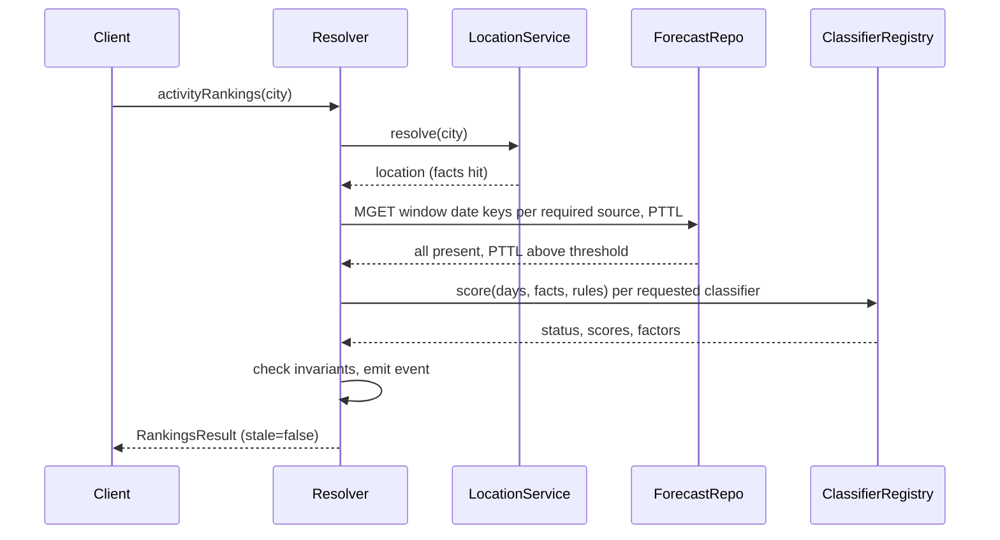
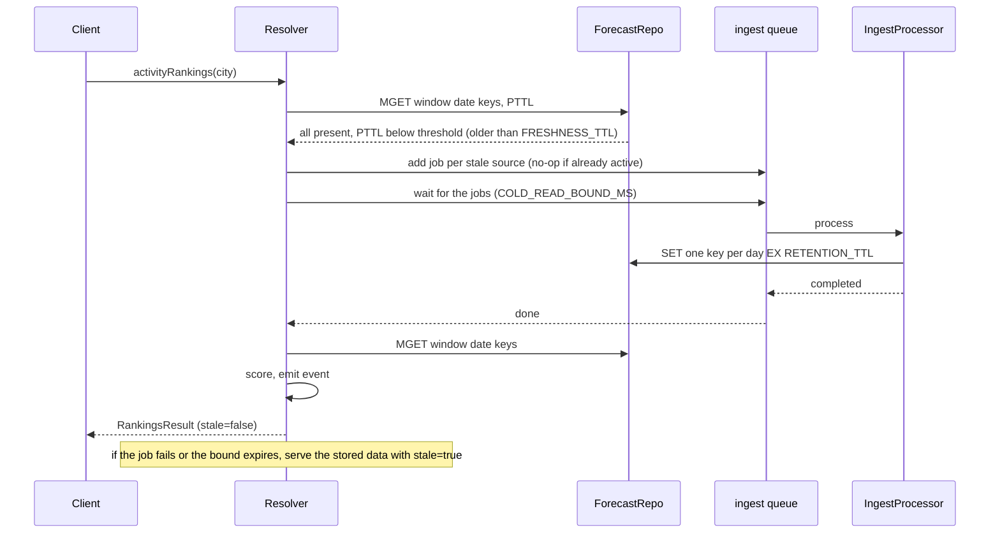

# Activity Ranking Service — Detailed Design

Implements [ADR-0001](adr/0001-pragmatic-option-nestjs-redis-bullmq.md). Each section carries a D-n id so the ADR, the options analysis and the implementation plan can point at it. Requirement, scenario and assumption IDs are defined in [arch/02-requirements.md](arch/02-requirements.md) and [arch/registers.md](arch/registers.md).

<a id="d-1"></a>
## D-1 Framework and modules

NestJS 12 on Node.js LTS, TypeScript, ESM (the Nest CLI 12 scaffold: Vitest, `type: module`, `.js` import suffixes). Five modules: `location` (geocoding adapter, facts repository), `weather` (forecast and marine adapters, forecast repository, ingest pipeline, queues), `ranking` (classifier registry, classifiers, rule-set provider, ranking service, events), `api` (GraphQL resolvers, error filter, throttler, complexity limit), `infra` (config, Redis client, logging, telemetry, health).

Allowed imports, the single source for the dependency-cruiser configuration (generic layer rules are in the [coding standards](CODING_STANDARDS.md#layering)):

```text
api        → ranking, location, weather (public barrels only), infra
ranking    → location (types), weather (types), infra
weather    → infra
location   → infra
infra      → nothing in the application
```

File postfixes follow the standards' layout table; this service adds `*.classifier.ts` with a sibling `*.rules.json` per activity.

| Piece | Role |
| --- | --- |
| `@nestjs/graphql` with the Apollo driver, code-first (`@apollo/server` 5, `@as-integrations/express5`, graphql 16) | Schema from decorators written to `schema.gql`; `Activity` enum built from the registry at startup; `includeStacktraceInErrorResponses: false` outside development |
| Zod with a ten-line `PipeTransform` | Zod schemas for arguments (the pipe throws `GraphQLError` with `BAD_USER_INPUT` and the issues), configuration and upstream payloads; types inferred from them. `nestjs-zod` rejected in spike S-2: peer range stops at Nest 11 and failures map to `BAD_REQUEST` |
| `@nestjs/throttler` with Redis storage | Inbound per-client limiter |
| `@nestjs/bullmq` (bullmq 6, ioredis 6 as its peer) | `ingest` and `enrich` queues; processors in-process behind `QUEUE_PROCESSORS_ENABLED`; `waitUntilFinished` with the cold-read bound (S-3) |
| `@nestjs/terminus` | `/health` with Redis and memory indicators |
| `@nestjs/config` | Environment configuration validated by Zod |
| `pino`, `@opentelemetry/sdk-node` | JSON logs; ranking events; `ranking_anomalies_total{type}` counter; console or OTLP exporter |
| `ioredis` | Behind `FactsRepository` and `ForecastRepository` interfaces |
| Vitest 4, autocannon | Test runner (decorator metadata handled by the Vite transform; `unplugin-swc` optional); performance smoke test |

<a id="d-2"></a>
## D-2 Configuration

Every knob is an environment variable, listed in `.env.example` with its default. No secrets exist in the exercise. One Zod `EnvSchema` parses `process.env` at bootstrap and the app refuses to start on a missing or malformed value, naming the key; refinements enforce `RETENTION_TTL > FRESHNESS_TTL` and `FETCH_DAYS > WINDOW_DAYS`; the inferred `Env` type is what the config service injects, and nothing else reads `process.env`.

| Variable | Default | Meaning |
| --- | --- | --- |
| `PORT` | `4510` | HTTP port; a non-default number so a reviewer's dev server on 3000 never collides ([ON-9](OVERNIGHT_NOTES.md#on-9)) |
| `REDIS_URL` | `redis://redis:6379` | Store and queues |
| `UPSTREAM_BASE_URL` | unset | One base URL for the whole provider: set, it replaces all three Open-Meteo hosts (geocoding, forecast, marine), which is how tests and the `demo` profile reach the stub upstream; unset or empty, each adapter uses its real host, a constant in `weather.const.ts` or `location.const.ts` ([A-53](arch/registers.md#a-53)) |
| `WINDOW_DAYS` | `7` | Days returned per activity ([FR-2](arch/02-requirements.md#fr-2)) |
| `FETCH_DAYS` | `8` | Days fetched per ingest; `WINDOW_DAYS + 1` covers local midnight |
| `FRESHNESS_TTL` | `6h` | Data older than this is refetched before it is served; served flagged stale only if the refetch fails |
| `RETENTION_TTL` | `24h` | Redis key TTL; must exceed `FRESHNESS_TTL`; sets how long an outage can be ridden out on stale data |
| `UPSTREAM_TIMEOUT_MS` | `2000` | Per upstream call |
| `UPSTREAM_RETRIES` | `1` | Retries per job, with backoff |
| `COLD_READ_BOUND_MS` | `4500` | How long a cold read waits for its jobs |
| `OUTBOUND_PER_MINUTE` | `500` | BullMQ queue limiter, under the 600 fair-use limit |
| `OUTBOUND_PER_DAY` | `9000` | Daily counter guard, under the 10,000 fair-use limit |
| `INBOUND_PER_MINUTE` | `60` | Per-client throttler |
| `QUERY_MAX_LOCATIONS` | `5` | Complexity limit on `rankings` selections per query |
| `GEOCODE_TTL` | `30d` | Geocode result retention |
| `QUEUE_PROCESSORS_ENABLED` | `true` | Run queue processors in this process |
| `LOG_LEVEL` | `info` | pino level |
| `OTEL_EXPORTER` | `console` | `console` or `otlp` |
| `NODE_ENV` | `production` | `development` writes `schema.gql` on start and includes stack traces in error responses; `test`; `production` ([ON-8](OVERNIGHT_NOTES.md#on-8)) |

<a id="d-3"></a>
## D-3 GraphQL schema

```graphql
type Query {
  activityRankings(city: String!, country: String, activities: [Activity!]): RankingsResult!
}

type RankingsResult {
  location: Location!
  rankings: [ActivityRanking!]!
  meta: Meta!
}

type ActivityRanking {
  activity: Activity!
  status: ActivityStatus!
  days: [DayScore!]!
}

type DayScore {
  date: Date!
  score: Int
  details: DayDetails
}

type DayDetails {
  factors: [Factor!]!
  signals: DaySignals!
}

type Factor {
  signal: String!
  value: Float
  unit: String
  effect: Effect!
  note: String
}

type Meta {
  fetchedAt: DateTime!
  stale: Boolean!
  partial: Boolean!
  sources: [SourceStatus!]!
  alternatives: [Location!]!
  reasons: [ActivityReason!]!
}

type ActivityReason {
  activity: Activity!
  reason: String!
}

type SourceStatus {
  source: Source!
  status: FetchStatus!
  fetchedAt: DateTime
}

type Location {
  id: ID!
  name: String!
  region: String
  country: String!
  latitude: Float!
  longitude: Float!
  timezone: String!
  elevation: Float
  rankings(activities: [Activity!]): RankingsResult!
}

type DaySignals {
  date: Date!
  tempMax: Float
  tempMin: Float
  precipitation: Float
  precipitationProbability: Float
  snowfall: Float
  snowDepth: Float
  windMax: Float
  windGusts: Float
  cloudCover: Float
  uvIndex: Float
  sunshineHours: Float
  visibility: Float
  weatherCode: Int
  waveHeight: Float
  wavePeriod: Float
  swellHeight: Float
}

enum Activity { SKIING SURFING OUTDOOR_SIGHTSEEING INDOOR_SIGHTSEEING }
enum ActivityStatus { APPLICABLE NOT_APPLICABLE UNAVAILABLE }
enum Source { FORECAST MARINE }
enum FetchStatus { OK FAILED SKIPPED }
enum Effect { POSITIVE NEGATIVE NEUTRAL }

scalar Date
scalar DateTime
```

Rules:

- The default answer is the brief's answer: a location, and per activity a status and `WINDOW_DAYS` `{date, score}` pairs in date order. `score` is 0 to 100, null when the activity is not applicable or unavailable. No rank field; ordering is the consumer's.
- `DayScore.details` and `Meta.reasons` are resolved only when selected. Selection is the "details" flag; nothing is computed or serialised otherwise.
- `Meta.stale`: the refetch failed and the stored data served is older than `FRESHNESS_TTL`; on the normal path it is always false. `Meta.partial`: a source failed; `sources` says which.
- `Location.rankings` is the link into an alternative's rankings; `QUERY_MAX_LOCATIONS` bounds it.
- Errors: `BAD_USER_INPUT`, `NOT_FOUND`, `UPSTREAM_UNAVAILABLE` with `retryAfterSeconds`, `RATE_LIMITED`, `QUERY_TOO_COMPLEX`.

<a id="d-4"></a>
## D-4 Redis data model

| Key | Value | TTL | Namespace |
| --- | --- | --- | --- |
| `location:v1:{id}` | name, country, admin1, latitude, longitude, elevation, timezone, marineDataAvailable (true, false, unknown), updatedAt | none | facts |
| `geocode:v1:{normalisedQuery}` | ordered list of location ids; first is the match used | `GEOCODE_TTL` | facts |
| `forecast:v1:{locationId}:{source}:{date}` | that day's signals, fetchedAt, providerSchemaVersion | `RETENTION_TTL` | forecast cache |
| `forecast:raw:{locationId}:{source}` | last raw upstream payload, for replay and drift checks | `RETENTION_TTL` | forecast cache |
| `ingest:last-error:{locationId}` | step, error, at | 7 days | operations |
| `fairuse:day:{date}` | counter | 2 days | operations |
| `bull:ingest:*`, `bull:enrich:*` | BullMQ internals | managed | queues |

Read, per required source: compute the window's dates in the location's timezone, one `MGET` over the date keys plus pipelined `PTTL`. Any key missing, or any `PTTL < RETENTION_TTL − FRESHNESS_TTL` (older than the freshness limit): enqueue that source's job and await it under `COLD_READ_BOUND_MS`, then serve fresh; cold and stale reads are one path. If the job fails or the bound expires and stored data exists, serve it flagged stale (degradation, [D-8](#d-8)); single-flight means every caller in the window waits on the same job, so the cost is one upstream round trip per expiry per location and source. Stale-while-revalidate was withdrawn at the Gate 4 review ([A-51](arch/registers.md#a-51)). Write: pipeline `SET … EX RETENTION_TTL` per day plus the raw payload. A window change is a set of missing keys; local midnight is one new date key, present because of the extra fetched day; expiry is native; a provider schema bump is a key-prefix change. A request-shaped key was rejected: it couples the cache to query shape and duplicates data across overlapping requests.

Facts live under keys without TTL and are the first storage class; they are the landing zone for enrichment ([ASR-5](arch/03-asrs.md#asr-5)). Redis runs with `appendonly yes` on a volume.

<a id="d-5"></a>
## D-5 Ingest pipeline and queues

Ingest is an extract-transform-load run per location and source, triggered by a request. One BullMQ job per `(locationId, source)`, job id `{locationId}__{source}` (BullMQ 6 rejects custom ids containing a single `:`; spike S-3): a duplicate add while a job is active is a no-op (single-flight); sources run in parallel as separate jobs; a per-source failure is a job outcome. Each job: fetch with `UPSTREAM_TIMEOUT_MS` (forecast: the daily variables plus hourly `snow_depth`, reduced to a daily maximum), validate the payload with the pinned Zod schema, normalise to `DaySignals`, write per-day keys and the raw payload. Queue options: limiter `OUTBOUND_PER_MINUTE` per minute, `attempts = UPSTREAM_RETRIES + 1` with exponential backoff, `removeOnComplete: true` so a later re-add runs again, `setMaxListeners` raised on `QueueEvents` because a cold read awaits several jobs; a daily `INCR` on `fairuse:day` guards `OUTBOUND_PER_DAY`. Policy per source: forecast mandatory, marine optional ([DF-6](arch/02-requirements.md#df-6)). Every run emits an event with duration and outcome; the last failure is kept under `ingest:last-error`.

Which sources a request needs is the union of `requires` over the requested classifiers ([DF-7](arch/02-requirements.md#df-7)). The `enrich` queue is registered with no processor in the exercise; an enrichment job would write facts and carry its own version (prompt version for an LLM job). Processors run in the API process behind `QUEUE_PROCESSORS_ENABLED` and move to a worker deployment unchanged.

<a id="d-6"></a>
## D-6 Classifier contract and registry

```ts
interface Classifier {
  readonly id: Activity;          // enum value, also the registry key
  readonly version: string;       // semver; prompt version for an LLM classifier
  readonly requires: Source[];    // sources the ingest must provide
  score(input: { days: DaySignals[]; facts: LocationFacts; rules: RuleSet }):
    Promise<{ status: ActivityStatus; reason?: string; days: Array<{ date: string; score: number | null; factors: Factor[] }> }>;
}
```

The registry is a map from `Activity` to `Classifier`, filled by module registration; the GraphQL `Activity` enum is built from its keys at startup. Thresholds are JSON per classifier, read through `RuleSetProvider`, whose static implementation exports `ruleSetVersion`; a configuration-service or database provider replaces it without touching classifiers ([A-46](arch/registers.md#a-46)). Applicability rules: surfing is `NOT_APPLICABLE` when marine data is absent (nulls) and `UNAVAILABLE` when the marine source failed; skiing is `NOT_APPLICABLE` when the place sits below 800 m (the geocoding elevation on `LocationFacts`; unknown elevation counts as below) and otherwise when no snow signal exists in the window; sightseeing activities are always applicable. Scores and factors come from threshold rules, one file per activity with a note per threshold ([R-7](arch/04-options.md#r-7)).

### D-6.1 Provisional thresholds

Proposals from spike S-6 (Open-Meteo daily ranges for Chamonix, Biarritz, London, Dubai and Springfield on 2026-10-14) plus general knowledge. Every number is a proposal, kept in the per-activity JSON with the note shown here, and revisited against the golden set ([H-1](arch/registers.md#h-1)). Weak or model-capped signals (visibility, sunshine, cloud cover, UV) carry low weight.

| Activity | Signal | Good | Poor | Not applicable | Note |
| --- | --- | --- | --- | --- | --- |
| Skiing | place elevation, m (geocoding) | — | — | < 800, or unknown | Checked before the snow gate. Owner decision 2026-10-15: ski terrain starts around 800 m; valley towns such as Chamonix at 1060 m qualify, London at 25 m does not ([A-8](arch/registers.md#a-8)) |
| Skiing | snow depth, cm (daily max of hourly `snow_depth`) | ≥ 30 | 5 to 15 | < 5 every day | Snowpack is the applicability signal. Probe 2026-10-14: Hintertux at 3250 m shows 39 cm and is open; Chamonix town 0. Known false negative: Sölden at 3340 m shows 0 because the model carries no snow on that glacier cell ([A-50](arch/registers.md#a-50), [R-12](arch/04-options.md#r-12)) |
| Skiing | snowfall, cm per day | ≥ 5 | 0 | — | Fresh snow is a bonus on top of the base, not the gate |
| Skiing | tmax, °C | −10 to 3 | > 8 | — | Above about 8 the snow rots |
| Skiing | wind gusts, km/h | < 40 | > 60 | — | Lifts close around 60 to 80 |
| Skiing | visibility, m | > 5000 | < 1000 | — | Whiteout risk; weak signal |
| Surfing | marine data | — | — | absent (nulls) or source failed (unavailable) | Inland locations |
| Surfing | wave height, m | 1.0 to 2.5 | < 0.5 or > 4 | < 0.5 every day | Separates Biarritz (1.2 to 2.0) from Dubai (0.1 to 0.4) |
| Surfing | wave period, s | ≥ 9 | < 6 | < 5 every day | Swell versus chop; the cleanest separator |
| Surfing | wind, km/h | < 20 | > 30 | — | Speed as proxy for blown-out surf; no direction signal |
| Outdoor sightseeing | precipitation, mm | < 1 | > 5 | — | Drizzle tolerable; 83 mm is not |
| Outdoor sightseeing | precipitation probability, % | < 30 | > 60 | — | |
| Outdoor sightseeing | temperature comfort, °C | tmax 15 to 27 and tmin ≥ 5 | tmax < 8 or > 32 | — | Dubai at 34 to 38 is poor from heat |
| Outdoor sightseeing | wind gusts, km/h | < 40 | > 55 | — | |
| Outdoor sightseeing | cloud cover, % | < 60 | > 90 | — | Soft signal, low weight |
| Outdoor sightseeing | UV index | ≤ 7 | ≥ 9 | — | Tie-breaker only |
| Indoor sightseeing | rain | > 5 mm or > 60 % | < 1 mm and < 30 % | never | Rain pushes people indoors |
| Indoor sightseeing | heat or cold, °C | tmax > 32 or < 8 | tmax 15 to 27 | never | |
| Indoor sightseeing | wind gusts, km/h | > 55 | < 40 | never | |
| Indoor sightseeing | baseline | floor score about 40 | — | never | Always available; fair on nice days, never poor |

Adjustments made when the golden set was run in phase 3 (2026-10-15, [H-1](arch/registers.md#h-1)): a weighted mean alone let Dubai at 38 °C score 78 for outdoor sightseeing because the dry, calm, sunny factors diluted the heat, so every rule set except indoor sightseeing carries a deal-breaker cap (`poorCap`: any factor in its poor band with weight 2 or more caps the day at 30, note "one disqualifying signal outweighs the rest"); and the skiing snow-depth poor band became "15 cm or less" so a bare day inside an applicable window counts as poor rather than neutral. Weights are 3 for the primary signal of each activity, 2 for the secondary ones, 1 or less for the soft signals, and are listed in each `*.rules.json`.

Golden-set fixtures are real days from the Open-Meteo archive endpoint (same daily shape, back to 1940, about five days behind real time; `past_days` on the forecast endpoint covers the gap), recorded once so tests stay offline: Chamonix 10 January 2026 (12.5 cm snowfall, tmax −2 °C) exercises the skiing branch, and the live pair Hintertux at 3250 m (39 cm snow depth) against Chamonix town (0) exercises the applicability gate. Town coordinates sit on valley floors (Chamonix grid elevation 1041 m, Hintertux default cell 2802 m against a 3250 m summit), which is why [A-8](arch/registers.md#a-8) keeps skiing on the town's own forecast; Open-Meteo's `elevation` parameter shifts the forecast by lapse rate, so resort elevation is a candidate location fact on the [ASR-5](arch/03-asrs.md#asr-5) seam.

<a id="d-7"></a>
## D-7 Traceability and anomaly detection

Each ranking request emits one structured event: request id, location id, provider, fetched-at per source, and per activity the classifier id and version, rule-set version, status, scores and factors. Invariants run in-request: score within 0 to 100; exactly `WINDOW_DAYS` dated scores per applicable activity; non-applicable activities carry no score; `marineDataAvailable` is a stored fact, so a change on refresh emits its own event. A violation logs at warn and increments `ranking_anomalies_total{type}`. Exercise: events to stdout as JSON. Production path: Datadog log pipeline and a monitor on the counter; the golden-set evaluation reads the same events offline.

<a id="d-8"></a>
## D-8 Degradation rules

| Situation | Behaviour |
| --- | --- |
| Store has the window, data stale, upstream healthy | Await the refetch job up to `COLD_READ_BOUND_MS`, serve fresh, `stale: false` |
| Store has the window, data stale, upstream failing or bound expired | Serve the stored data, `stale: true`, `sources` shows the failure |
| Store missing a source, upstream healthy | Await the job up to `COLD_READ_BOUND_MS`, serve fresh |
| Store missing the forecast source, upstream failing | `UPSTREAM_UNAVAILABLE` with `retryAfterSeconds` and the resolved location |
| Store missing marine only, upstream failing | Serve; surfing `UNAVAILABLE`; `partial: true`; `sources` shows `MARINE: FAILED` |
| Payload fails schema validation | Treated as a failed source; anomaly event; raw payload kept |
| Geocoding fails | `UPSTREAM_UNAVAILABLE` |
| No geocoding match | `NOT_FOUND` naming the input; no forecast call |

<a id="d-9"></a>
## D-9 Sequences

### Warm read ([QAS-1](arch/02-requirements.md#qas-1))



### Cold read ([QAS-2](arch/02-requirements.md#qas-2))

```mermaid
sequenceDiagram
    participant C as Client
    participant R as Resolver
    participant L as LocationService
    participant G as Geocoding API
    participant Q as ingest queue
    participant P as IngestProcessor
    participant OM as Forecast and Marine APIs
    participant F as ForecastRepo
    C->>R: activityRankings(city)
    R->>L: resolve(city)
    L->>G: search(name, count=5)
    G-->>L: matches
    L->>L: write location facts and geocode key
    L-->>R: location, alternatives
    R->>Q: add one job per required source (jobId=locationId__source)
    R->>Q: wait for the required jobs (COLD_READ_BOUND_MS)
    Q->>P: process
    par per source
        P->>OM: forecast(FETCH_DAYS)
        P->>OM: marine(FETCH_DAYS) if a requested classifier requires it
    end
    OM-->>P: payloads
    P->>P: validate (zod, pinned schema), normalise
    P->>F: SET one key per day EX RETENTION_TTL; SET raw payload
    P-->>Q: completed
    Q-->>R: done
    R->>F: MGET window date keys
    R->>R: score, emit event
    R-->>C: RankingsResult (stale=false)
```

### Stale read, refresh on read ([QAS-4](arch/02-requirements.md#qas-4))



### Upstream failure ([QAS-3](arch/02-requirements.md#qas-3), [QAS-11](arch/02-requirements.md#qas-11))

```mermaid
sequenceDiagram
    participant C as Client
    participant R as Resolver
    participant F as ForecastRepo
    participant Q as ingest queue
    participant P as IngestProcessor
    participant OM as Open-Meteo
    C->>R: activityRankings(city)
    R->>F: MGET window date keys, PTTL
    alt stored data exists
        F-->>R: stale keys
        R->>Q: add job per stale source, wait (COLD_READ_BOUND_MS)
        Q->>P: process
        P->>OM: forecast
        OM-->>P: timeout or 5xx
        P->>P: retry once, fail; write ingest:last-error; emit event
        P-->>Q: failed
        Q-->>R: failed
        R-->>C: RankingsResult from stored data (stale=true)
    else store empty
        R->>Q: add and wait (COLD_READ_BOUND_MS)
        Q->>P: process
        P->>OM: forecast
        OM-->>P: timeout or 5xx
        P-->>Q: failed
        Q-->>R: failed
        R-->>C: error UPSTREAM_UNAVAILABLE, retryAfterSeconds, location
    end
    note over P: marine-only failure: forecast keys written, surfing UNAVAILABLE, partial=true
```

Adding an activity ([QAS-7](arch/02-requirements.md#qas-7)) is not a runtime sequence: one classifier module exporting `id`, `version`, `requires`, `score`, one registry entry; the `Activity` enum regenerates at startup; a test registers a fake activity and asserts it appears.

<a id="d-10"></a>
## D-10 Test layout

The full plan, with the traceability matrix from every requirement and scenario to named test cases, coverage gates per module, fixtures and non-functional verification, is the [test plan](ACTIVITY_RANKING_TEST_PLAN.md). This section is the summary.

| Level | Scope | Runs against |
| --- | --- | --- |
| Unit | Classifiers against fixture `DaySignals`, including the golden set recorded from the archive endpoint (winter and summer days per golden city); rule-set provider; throttler and complexity config; invariant checks | Nothing external |
| Integration | Adapters against recorded Open-Meteo payloads; repositories and the ingest processor against a Redis service; refresh-on-read and degradation paths | Redis container in CI |
| Schema and contract | Generated SDL snapshot; the default query and a details query as contract fixtures; Pact consumer contract described as the production path | Nothing external |
| End-to-end | One query through `app.listen(0)` over `fetch` with stubbed adapters: warm, cold, stale, unknown name, marine failure | Redis container |
| Performance | autocannon against the running service: p95 of warm reads, wall time of one cold read; `INBOUND_PER_MINUTE` raised for the run | Optional CI job |

A fixture-backed stub upstream container serves recorded Open-Meteo payloads for end-to-end tests, the load job and the `demo` Compose profile. Hooks: lefthook with lint-staged (eslint, prettier) and `tsc --noEmit` on pre-commit, commitlint on commit-msg, unit and integration on pre-push. CI gates: lint, type check, unit, integration, schema, end-to-end, coverage threshold 80 percent on `ranking` and `weather`, compose health check; under 5 minutes; zero live calls to Open-Meteo. Load job with asserted thresholds on `main` and nightly. Every behaviour is written test-first; each phase is a pull request merged green.

<a id="d-11"></a>
## D-11 Delivery

Multi-stage Dockerfile (build, runtime on Node LTS alpine, non-root). `docker-compose.yml`: `api` and `redis` (`appendonly yes`, volume). GitHub Actions on every push: install with a frozen lockfile, lint, type check, tests with a redis service container, image build, `helm lint`. `deploy/helm/activity-ranking`: a chart skeleton with a Deployment, Service, HPA, ConfigMap from `.env.example`, probes on `/health`; values for image and Redis URL; not deployed. Production path, described in the README: image to ECR, `helm upgrade` to EKS, Terraform for VPC, EKS, ElastiCache and ECR, Aurora for facts once enrichment lands, OTLP to Datadog.
