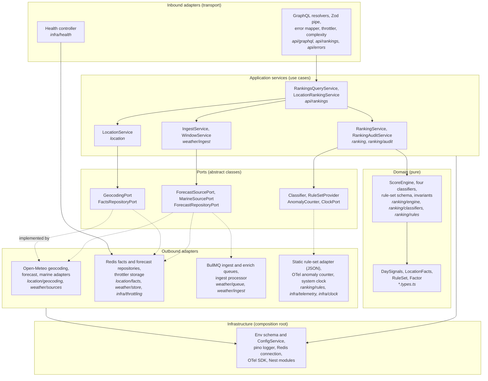
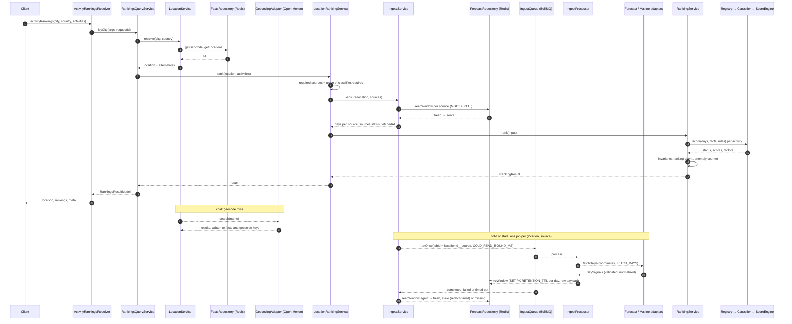

# Activity Ranking Service — Layers, Flow and Folder Structure

A hexagonal (ports and adapters) reading of the code as it stands after the 2026-10-15 review, the request flow across services, the folder structure that carries it, and three change scenarios with their touch points. Mechanisms are in the [design document](ACTIVITY_RANKING_DESIGN.md); this page is the map.

## 1. Layers

The dependency rule: arrows point inwards. Inbound adapters call application services; application services call domain logic and talk to the outside only through ports; outbound adapters implement the ports; infrastructure is the composition root and the shared utilities. Domain code imports nothing from Nest, Redis, BullMQ or HTTP.



What this is, in one sentence: vertical slices by data domain (`location`, `weather`, `ranking`, `api`), each slice carrying its own ports and adapters, with `infra` as the shared base. The slice names are the data they own, which is why `weather/store` holds the forecast store and `location/facts` holds the location store: each store belongs to the data it persists.

## 2. Request flow

Warm read (data fresh in Redis) and cold read (first request for a place) on one diagram; the cold branches are the dashed ones.



## 3. Folder structure

The tree that carries the layers above. Every folder is a Nest module; the feature barrel (`index.ts` at the feature root) is the only cross-feature import, enforced by dependency-cruiser.

```text
src/
  app.module.ts, main.ts
  infra/        composition root and shared utilities
    config/     EnvSchema, ConfigService          clock/      ClockPort, SystemClock
    logging/    pino AppLogger                     redis/      connections for ioredis and BullMQ
    telemetry/  OTel SDK, AnomalyCounter port+impl throttling/ Redis throttler storage
    health/     /health controller and indicator
  location/     slice: place resolution
    location.service.ts (application), location.types.ts, location.util.ts
    geocoding/  GeocodingPort, Open-Meteo geocoding adapter + schema   (outbound adapter)
    facts/      FactsRepositoryPort, Redis facts repository             (outbound adapter)
  weather/      slice: forecast data
    weather.types.ts (DaySignals), weather.const.ts
    sources/    WeatherSourcePort; forecast/ and marine/ Open-Meteo adapters (outbound adapters)
    store/      ForecastRepositoryPort, Redis forecast repository        (outbound adapter)
    queue/      BullMQ ingest and enrich queues                          (outbound adapter)
    ingest/     IngestService, WindowService (application); IngestProcessor (ETL worker)
  ranking/      slice: scoring
    ranking.service.ts (application), ranking.types.ts, ranking.util.ts
    engine/     ScoreEngine (domain)        rules/     RuleSetProvider port, schema, static JSON adapter
    registry/   Classifier port, registry   audit/     invariants, events, anomaly counter use
    classifiers/skiing, surfing, outdoor-sightseeing, indoor-sightseeing (domain, one module each)
  api/          inbound adapter
    graphql/    driver config, complexity plugin, throttler guard, scalars
    errors/     error mapper and filter       models/    GraphQL object types and enums
    rankings/   resolvers, RankingsQueryService, LocationRankingService, mapper, Zod pipe and arg schemas
```

### 3.1 An alternative: folders named by hexagonal layer

The same code can be laid out with the layer as the first-level folder, which makes the hexagon visible in the tree at the cost of splitting each data domain across three folders. This is the shape to choose if "where is the store?" should be answered by the layer, not by the data:

```text
src/
  domain/        pure: day-signals.types, location-facts.types, ranking/{engine, rules schema, classifiers, invariants}
  application/   use cases and the ports they need:
                 resolve-location/ (LocationService; GeocodingPort, FactsRepositoryPort)
                 ensure-forecast/  (IngestService, WindowService; WeatherSourcePort, ForecastRepositoryPort, IngestQueuePort)
                 rank/             (RankingService, audit; RuleSetProvider, AnomalyCounter, ClockPort)
                 activity-rankings/ (RankingsQueryService, LocationRankingService)
  adapters/
    inbound/     graphql/ (resolvers, models, pipe, errors, complexity, throttler), health/
    outbound/    open-meteo/ (geocoding, forecast, marine), redis/ (facts, forecast, throttler storage),
                 bullmq/ (queues, processor), rules-json/ (static rule sets), otel/ (anomaly counter)
  infra/         config, logging, connections, telemetry SDK, module wiring
```

Trade-off: the current slices keep everything about one data domain within one folder and scale by adding slices (an `enrichment` slice later); the layered tree keeps the hexagon explicit and scales by adding adapters. Dependency-cruiser enforces the same rules either way. The move is a rename-only refactor of about ninety files plus module wiring.

## 4. Change scenarios

Touch points count existing files edited; new files are listed separately. Complexity is the kind of reasoning the change needs. The modifiability score is 1 to 5, where 5 means "one new unit, one registration, nothing else".

| Scenario | New files | Existing files touched | What stays untouched | Complexity | Score |
| --- | --- | --- | --- | --- | --- |
| Add a fifth classifier (for example cycling on wind and rain) | one folder `ranking/classifiers/cycling/` with module, classifier, rules JSON, spec | 2: the import in `ranking.module.ts` and the rule-file entry in `rules/rules.const.ts` (plus the schema snapshot, which regenerates) | ingest, store, API resolvers and models (the `Activity` enum is built from the registry), existing classifiers and their tests | low: thresholds and a note per factor; the engine does the scoring | 4 (5 once the classifier module registers its own rule set, removing the const entry) |
| Add another geo or weather provider (for example a second forecast model, or a second geocoder) | one folder `weather/sources/<provider>/` (or `location/geocoding/<provider>/`) with module, adapter, pinned payload schema, normaliser, spec; recorded fixtures and a stub route for tests | 3: the port binding in `sources.module.ts` (or `geocoding.module.ts`), a `WEATHER_PROVIDER` or `GEOCODING_PROVIDER` key in `env.schema.ts`, `.env.example` | store (keys and `DaySignals` are provider-neutral), ingest, classifiers, API; raw payloads keep their provider schema version | medium: mapping the provider's variables and units onto `DaySignals`, recording fixtures, deciding the selection rule (env switch now; per-location routing later) | 4 |
| Scale horizontally (several API instances, separate workers) | one Helm template `worker-deployment.yaml` and its values | 1 to 2: `values.yaml` (replicas, worker image args), `docker-compose.yml` if a local worker service is wanted | application code: the process is stateless; Redis holds facts, forecast, geocode, throttle and fair-use counters; BullMQ job ids give cluster-wide single-flight and the queue limiter is shared through Redis; `QUEUE_PROCESSORS_ENABLED=false` on API pods moves processors to the worker Deployment unchanged | low: deployment wiring; Redis becomes the component to make highly available (ElastiCache) | 4 (the worker Deployment template is not in the chart yet; readiness and liveness share one endpoint) |

Overall maintainability: 4 of 5. Strong points: ports everywhere an external system is touched, provider-neutral store, scoring on read, lint-enforced layering, per-file test coverage. Weak points: slice names answer "which data" rather than "which layer", which is what section 3.1 addresses; two registrations for a new classifier instead of one; the worker Deployment exists only as an environment flag.
