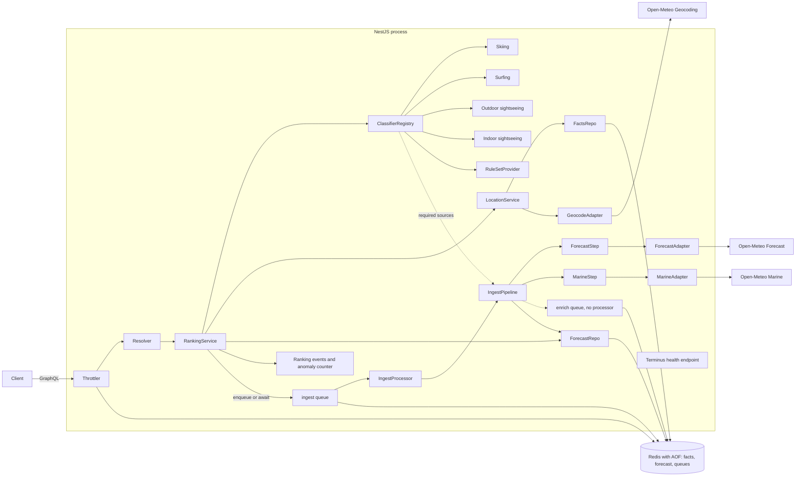

# Step 4 — Recommendation

Part of the [architecture process](../ACTIVITY_RANKING_ARCH_PROCESS.md). Options are characterised in [04-options.md](04-options.md). The decision itself lives in the [ADR log](../adr/README.md); the detailed design that implements it is the [design document](../ACTIVITY_RANKING_DESIGN.md), referenced as D-n.

## Recommendation

Option C, phased so each phase leaves a working service, with Option B documented as the production path. The single High/High leaf of the utility tree, classifier extensibility, is met equally by all options. C wins the High/Medium leaves that A covers only on one instance: durable, deduplicated revalidation ([ASR-3](03-asrs.md#asr-3)), fair use through the queue limiter ([NFR-9](02-requirements.md#nfr-9)), deployability with a Helm skeleton and Redis in CI ([NFR-10](02-requirements.md#nfr-10), goal 5). The price over A is about two hours, part of it returned because BullMQ replaces hand-written lock and limiter code. B fails goal 3, the one-evening box. C degrades to A if time runs out: the Helm skeleton, the performance smoke test and the OpenTelemetry exporter are cut first, BullMQ last. Spikes S-1 to S-6 ran on 2026-10-14: the toolchain holds with plain Zod instead of `nestjs-zod`, BullMQ job ids use `__`, read latency is in single-digit milliseconds, and `@defer` is dropped.

## Architecture decision record

The decision is recorded as [ADR-0001](../adr/0001-pragmatic-option-nestjs-redis-bullmq.md) in the [ADR log](../adr/README.md). Its status moves to accepted at Gate 4 sign-off; later changes supersede it with new records rather than editing it.

## Component diagram

## Design artifacts

Detailed design lives in the [design document](../ACTIVITY_RANKING_DESIGN.md), linked to this decision by section:

| Section | Content | Decision it implements |
| --- | --- | --- |
| [D-1](../ACTIVITY_RANKING_DESIGN.md#d-1) | Framework and modules | [ADR-0001](../adr/0001-pragmatic-option-nestjs-redis-bullmq.md), [ASR-1](03-asrs.md#asr-1) |
| [D-2](../ACTIVITY_RANKING_DESIGN.md#d-2) | Configuration (environment variables) | [A-36](registers.md#a-36), [A-49](registers.md#a-49) |
| [D-3](../ACTIVITY_RANKING_DESIGN.md#d-3) | GraphQL schema | [FR-1](02-requirements.md#fr-1) to [FR-4](02-requirements.md#fr-4), [DF-1](02-requirements.md#df-1) to [DF-7](02-requirements.md#df-7) |
| [D-4](../ACTIVITY_RANKING_DESIGN.md#d-4) | Redis data model, read and write paths | [ASR-2](03-asrs.md#asr-2), [ASR-3](03-asrs.md#asr-3), [ASR-5](03-asrs.md#asr-5), [A-47](registers.md#a-47), [A-49](registers.md#a-49) |
| [D-5](../ACTIVITY_RANKING_DESIGN.md#d-5) | Ingest pipeline and queues | [ASR-3](03-asrs.md#asr-3), [ASR-4](03-asrs.md#asr-4) |
| [D-6](../ACTIVITY_RANKING_DESIGN.md#d-6) | Classifier contract and registry | [ASR-1](03-asrs.md#asr-1), [A-46](registers.md#a-46) |
| [D-7](../ACTIVITY_RANKING_DESIGN.md#d-7) | Traceability and anomaly detection | [NFR-13](02-requirements.md#nfr-13) |
| [D-8](../ACTIVITY_RANKING_DESIGN.md#d-8) | Degradation rules | [ASR-4](03-asrs.md#asr-4), [DF-6](02-requirements.md#df-6) |
| [D-9](../ACTIVITY_RANKING_DESIGN.md#d-9) | Sequence diagrams for [QAS-1](02-requirements.md#qas-1), [QAS-2](02-requirements.md#qas-2), [QAS-4](02-requirements.md#qas-4), [QAS-3](02-requirements.md#qas-3) and [QAS-11](02-requirements.md#qas-11) | QAS |
| [D-10](../ACTIVITY_RANKING_DESIGN.md#d-10) | Test layout | [NFR-6](02-requirements.md#nfr-6) |
| [D-11](../ACTIVITY_RANKING_DESIGN.md#d-11) | Delivery: Dockerfile, Compose, GitHub Actions, Helm skeleton | [NFR-10](02-requirements.md#nfr-10) |

## Spikes before sign-off

These run before the path is chosen. Each spike is throwaway code with an acceptance check, a time box and a named fallback, so a failure swaps one component rather than the whole option.

| Spike | Verifies | Build | Passes when | Box | If it fails | Result |
| --- | --- | --- | --- | --- | --- | --- |
| S-1 | [H-8](registers.md#h-8) toolchain | `nest new`, Vitest, `unplugin-swc` with decorator metadata; one test on a decorated provider | Test green under Vitest; DI resolves | 15 min | Jest | passed 2026-10-14: Nest 12.1.3, Vitest 4.1; Nest CLI 12 scaffolds Vitest and ESM by default; the SWC plugin is optional |
| S-2 | [H-8](registers.md#h-8) validation | One code-first resolver; `@Args` through a Zod pipe from `nestjs-zod` | Bad input returns `BAD_USER_INPUT`; good input resolves; schema generates | 15 min | class-validator | passed with a swap 2026-10-14: `nestjs-zod` conflicts with Nest 12 peers and returns `BAD_REQUEST`; a ten-line Zod pipe returns `BAD_USER_INPUT`; `@as-integrations/express5` is required by Apollo 5 under Nest |
| S-3 | [H-8](registers.md#h-8) queue pattern | Redis in Docker; BullMQ queue and in-process worker; `add` with a job id, `removeOnComplete: true`, `waitUntilFinished` with a timeout; limiter 5 per second | Concurrent adds run once; a re-add after completion runs again; the wait times out cleanly; the limiter throttles | 20 min | In-request promise with in-memory single-flight, the option A shape | passed 2026-10-14 on bullmq 6.3: dedup once, re-add runs again with `removeOnComplete`, wait rejects at 1.5 s without hanging, limiter throttles 20 jobs to 3.1 s; job id must not contain a single `:`, so `{locationId}__{source}` |
| S-4 | [H-5](registers.md#h-5) read latency | Stub resolver doing `MGET` of seven keys plus `PTTL` on local Redis; autocannon for 30 s | p95 under 300 ms | 10 min | Result cache later; store unchanged | passed 2026-10-14: p95 at most 3 ms at 50 connections, 26k requests per second on loopback (Redis 8.1) |
| S-5 | [H-7](registers.md#h-7) `@defer` | Apollo driver; one deferred field; check the graphql-js version | Multipart response arrives, or it is confirmed to need graphql-js 17 | 15 min | Tier 2 dropped and noted | failed 2026-10-14: `Unknown directive @defer` on graphql 16.14; works only pinned to `17.0.0-alpha.9` with a schema workaround and the `incrementalSpec=v0.2` header; tier 2 dropped |
| S-6 | [H-1](registers.md#h-1), [R-7](04-options.md#r-7) thresholds | Curl Open-Meteo daily for the five golden cities today; tabulate ranges of snowfall, temperature, wind, precipitation and wave height | Threshold values per activity chosen from real ranges, one note each | 15 min | Thresholds stay provisional, flagged in the README | passed 2026-10-14: [D-6.1](../ACTIVITY_RANKING_DESIGN.md#d-61-provisional-thresholds) |

[H-4](registers.md#h-4) stays post-exercise; nothing in the decision depends on it.

## Closed artifacts

Registers are closed in [registers.md](registers.md): every open assumption is deferred to the README assumptions list with the lead reviewer as the person who can overturn it; every open question has the same owner and the review as its deadline; risks carry their accepted status for Option C in [04-options.md](04-options.md#risk-register); hypotheses carry a scheduled phase, a probe result, or a post-exercise deferral.

> **Review Gate 4 — Architecture Sign-off** — closed 2026-10-15 after spikes S-1 to S-6 and the refresh-flow revision. ADR-0001 accepted.
